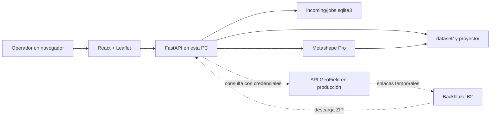

# GeoField · Motor local de procesamiento

Aplicación de escritorio servida por navegador para preparar vuelos de dron y
procesarlos con Agisoft Metashape en esta PC. El frontend muestra el mapa, los
proyectos, la cola de trabajos, los puntos GPS, el ROI, los ortomosaicos y los
logs. El backend administra archivos y turnos; Metashape hace la fotogrametría
en un proceso separado.

> Estado: el procesamiento local funciona. El receptor de ZIP desde la web de
> producción está implementado pero requiere configuración y una prueba real.
> La entrega del ortomosaico a producción todavía no está implementada.

## Mapa del sistema



El flujo de recepción previsto es **saliente desde esta PC**: el receptor
consulta la API de producción y descarga ZIP desde B2. Funnel puede exponer la
interfaz local, pero no transporta por sí mismo los ZIP de ese flujo. La UI y el
estado activo del backend son compartidos entre quienes acceden a la misma
instancia; este proyecto todavía no ofrece sesiones aisladas por usuario.

## Requisitos y arranque

- Windows con Agisoft Metashape Pro instalado. La ruta predeterminada es
  `C:\Program Files\Agisoft\Metashape Pro\metashape.exe`; puede cambiarse con
  `METASHAPE_EXE`.
- Python con los paquetes de `requirements.txt`. El proceso observado en esta
  PC usa Python 3.14; CI comprueba sintaxis con Python 3.11.
- Node.js 20 o superior para compilar el frontend. `frontend/package.json`
  contiene los comandos de Vite.

Desde la raíz del repositorio, en PowerShell:

```powershell
python -m pip install -r requirements.txt
cd frontend
corepack pnpm install --frozen-lockfile
corepack pnpm build
cd ..
python app.py
```

Abre `http://127.0.0.1:8001`. `app.py` inicia Uvicorn en `127.0.0.1` y usa
el puerto `8001`, salvo que se defina `PORT`. FastAPI sirve el build de
`frontend/dist/`; si falta, muestra una página que pide compilarlo. Para detener
una ejecución en primer plano, usa `Ctrl+C` en esa consola. El proceso no es un
servicio de Windows y debe estar activo para atender la interfaz.

Para desarrollo de interfaz existe `npm run dev` en `frontend/`, por defecto en
el puerto 5173. La configuración actual de Vite solo redirige algunas rutas;
para probar **todo** el flujo de trabajos y proyectos, usa el frontend compilado
desde el puerto 8001.

## Uso desde la interfaz

1. **Crear proyecto:** escribe un nombre y selecciona Mavic 3 RGB, Mavic 3 MS
   o MicaSense RedEdge-M. También puedes abrir un proyecto guardado.
2. **Cargar imágenes:** sube un ZIP local, importa desde Drive/rclone o prepara
   un trabajo recibido. El mapa muestra las ubicaciones GPS como puntos azules
   y el modal indica cuántas fotos válidas se encontraron.
3. **Configurar ROI:** importa KML, KMZ, GeoJSON o shapefile en ZIP, o dibuja un
   polígono sobre el mapa. Puedes mostrarlo, ocultarlo o quitar el recorte.
4. **Procesar proyecto:** el botón inicia Metashape. La interfaz consulta avance,
   logs y cola aproximadamente cada 3.5 segundos; también permite detener el
   proceso.
5. **Revisar y continuar:** visualiza el ortomosaico en el mapa, guarda y vuelve
   al mapa base. Desde **Proyectos** puedes abrir resultados anteriores o borrar
   un proyecto y, si nadie más usa su dataset, también sus fotos.

La campanita **Trabajos recibidos** lista nombre, organización, cantidad de ZIP,
estado, fecha y sensor. Solo el primer trabajo **En espera** puede prepararse;
la preparación extrae las fotos y crea el proyecto, pero **no inicia Metashape**.
El operador revisa ROI y pulsa **Procesar proyecto**. Mientras un trabajo está
preparándose, preparado o procesándose, otro no toma el turno. El siguiente se
habilita al terminar y cerrar/guardar el proyecto actual. La notificación es
local en la interfaz; no se envía correo ni aviso al navegador del remitente.

### Prueba local sin credenciales

Con `python app.py` en ejecución y un ZIP real de fotos, desde la raíz:

```powershell
python .\scripts\simular_trabajo_local.py --nombre "Vuelo de prueba" "C:\ruta\vuelo.zip"
```

El script copia el ZIP a `incoming/prueba_local/` y registra el trabajo en la
misma cola SQLite. Abre la campanita, selecciona sensor y pulsa **Preparar**.
El rótulo **Receptor sin configurar** sigue siendo normal en esta prueba:
indica que faltan las credenciales de producción. El ZIP original no cambia.

## Flujo de procesamiento

`POST /procesar` llama a `backend/services/process.py`, que inicia
`metashape.exe -r backend/main.py` con las rutas y sensor del proyecto en
variables de entorno. `backend/main.py` ejecuta cinco etapas:

1. Cargar fotos.
2. Alinear cámaras.
3. Construir y exportar el DEM.
4. Construir ortomosaicos.
5. Exportar GeoTIFF finales, aplicando el recorte si existe un ROI.

`backend/workflow.py` contiene el tratamiento de Mavic RGB, Mavic 3 MS y
MicaSense RedEdge-M. La exportación multiespectral conserva el orden de bandas
que corresponde a cada sensor. La resolución configurada para MS es 0.20 m;
RGB usa su configuración de exportación propia. El proceso escribe un log en
`logs/`; el backend también recoge su salida para el modal **Logs**.

## Archivos y persistencia

| Ruta | Contenido |
| --- | --- |
| `dataset/<dataset_id>/` | Fotos extraídas, una carpeta por dataset. |
| `proyecto/<project_id>/proyecto.json` | Sensor, dataset asociado e ID del proyecto. |
| `proyecto/<project_id>/<project_id>.psx` | Proyecto Agisoft Metashape. |
| `proyecto/<project_id>/<project_id>_rgb.tif` | Ortomosaico RGB, cuando el sensor/flujo lo produce. |
| `proyecto/<project_id>/<project_id>_ms.tif` | Ortomosaico multiespectral, cuando aplica. |
| `proyecto/<project_id>/*dem*.tif` | DEM exportado. |
| `proyecto/<project_id>/recorte_ortomosaico.geojson` | ROI activo del proyecto, si existe. |
| `incoming/<organización>/<lote>/` | ZIP originales descargados o registrados para prueba. |
| `incoming/jobs.sqlite3` | Cola, archivos recibidos y asociación lote–proyecto. |
| `logs/` | Logs de ejecuciones de Metashape. |

También pueden existir TIFF por polígono, según el tipo de recorte. `dataset/`,
`proyecto/`, `incoming/`, `logs/`, `frontend/dist/` y los entornos locales están
ignorados por Git. No elimines los archivos de estas carpetas para limpiar el
código: contienen trabajos y datos de la PC.

## Backend y API local

| Archivo | Responsabilidad |
| --- | --- |
| `app.py`, `backend/application.py` | Entrada Uvicorn, FastAPI y arranque del receptor. |
| `backend/routes.py` | API HTTP y entrega del frontend compilado. |
| `backend/core/state.py`, `backend/core/catalog.py` | Estado activo y catálogo persistente. |
| `backend/services/projects.py`, `ingestion.py` | Proyectos, datasets, ZIP local, Drive/rclone y GPS. |
| `backend/services/job_receiver.py` | Consulta remota, descarga B2 y cola SQLite. |
| `backend/services/job_handoff.py` | Turno, extracción segura y creación de proyecto recibido. |
| `backend/services/process.py`, `backend/main.py`, `backend/workflow.py` | Lanzamiento, seguimiento y procesamiento Metashape. |
| `backend/services/vector_overlay.py`, `clip.py`, `overlay.py` | ROI, recortes y tiles de visualización. |

Rutas principales:

| Rutas | Uso |
| --- | --- |
| `GET /status`, `/logs`, `/ingesta/estado` | Estado, logs e imágenes del dataset activo. |
| `GET /trabajos`, `/trabajos/{org}/{batch}/archivos` | Cola y ZIP de un lote. |
| `POST /trabajos/{org}/{batch}/preparar` | Toma el turno; requiere `camera_model`. |
| `GET /proyectos`, `POST /proyecto/nuevo`, `/proyectos/seleccionar` | Catálogo, creación y selección. |
| `POST /proyecto/finalizar`, `/proyecto/cerrar`; `DELETE /proyectos/{id}` | Continuar o borrar. |
| `POST /ingesta/zip`, `/ingesta/drive`; `POST /datasets/seleccionar` | Entrada manual de fotos. |
| `POST /overlay/vector`, `/overlay/vector/roi`, `/overlay/shapefile` | Carga y dibujo del ROI. |
| `GET /overlay/status`, `/tiles/rgb/{z}/{x}/{y}.png` | Disponibilidad y tiles RGB. |
| `POST /procesar`, `POST /stop` | Iniciar o detener Metashape. |

`GET /docs` muestra el esquema OpenAPI de FastAPI. El estado de la sesión activa
vive en memoria del proceso, mientras proyectos y cola sobreviven en disco. No
ejecutes varias instancias del backend sobre las mismas carpetas y base SQLite
esperando sesiones independientes.

## Frontend

`frontend/src/App.jsx` implementa el mapa Leaflet, los botones circulares,
modales de trabajos, proyectos, imágenes, ROI y logs, además del sondeo de la
API. `frontend/src/styles.css` contiene los estilos y ajustes móviles;
`frontend/src/utils/` contiene cliente HTTP, constantes y formatos. Vite genera
`frontend/dist/`, que FastAPI sirve desde la misma URL.

## Acceso remoto

La app escucha en `127.0.0.1`; Tailscale Serve o Funnel pueden darle acceso
remoto mediante su configuración independiente. Los comandos locales usados
para ello están en [`run_tunnel_tailscale.md`](run_tunnel_tailscale.md).
Actualmente la API local no exige inicio de sesión y la UI no separa estados
por visitante. Quien pueda abrir esa URL también puede ver proyectos, iniciar
procesos y usar acciones de borrado; la URL pública no debe confundirse con
el canal autenticado del receptor de ZIP.

## Integración con la web de producción

Para activar el receptor, completa `.env.receiver.local` con la URL de la API,
URL y clave pública de Supabase y una cuenta con permiso de descarga. Usa
`receptor.env.example` como plantilla. La contraseña y demás valores locales
no se versionan.

```powershell
powershell -NoProfile -ExecutionPolicy Bypass -File .\iniciar_receptor.ps1 -ValidateOnly
powershell -NoProfile -ExecutionPolicy Bypass -File .\iniciar_receptor.ps1
```

El segundo comando arranca el servidor con el receptor. Si `python app.py` ya
ocupa el puerto, detén esa instancia primero. El receptor consulta periódicamente
los lotes `received`, pide URLs autorizadas y descarga ZIP directamente desde
B2; guarda parciales para reanudar y marca el lote local **En espera**. Con las
variables vacías, `python app.py` sigue funcionando para uso local.

La documentación de producción recibida se conserva en
[`README-FLUJO-PROCESAMIENTO.md`](README-FLUJO-PROCESAMIENTO.md). El detalle del
receptor está en [`docs/RECEPTOR_TRABAJOS.md`](docs/RECEPTOR_TRABAJOS.md).
La entrega futura de resultados está delimitada en
[`docs/ENTREGA_RESULTADOS.md`](docs/ENTREGA_RESULTADOS.md): la API de producción
documentada hoy **no tiene un contrato para adjuntar o publicar los TIFF**.
Cambiar un lote a `done` no publica el ortomosaico ni lo envía a MapTiler.

## Comprobaciones

```powershell
python -m unittest discover -s tests
cd frontend
corepack pnpm build
```

Las pruebas cubren proyectos, cola, preparación, ROI y recortes sin requerir
una ejecución real de Metashape. CI compila el frontend y comprueba sintaxis
del backend. La prueba completa de fotogrametría requiere fotos reales y
Metashape instalado en esta PC.

## Referencias para continuar

- [`MEMORY.md`](MEMORY.md): estado de trabajo y pendientes actuales.
- [`.agents/skills/geofield-motor/SKILL.md`](.agents/skills/geofield-motor/SKILL.md): guía breve para trabajar en este repositorio.
